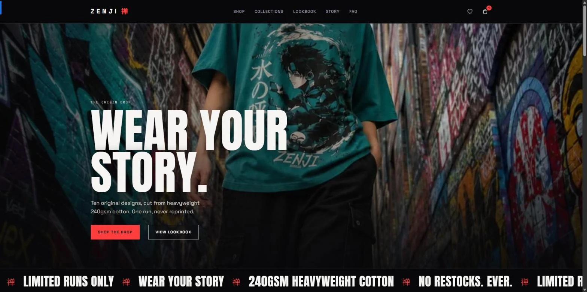
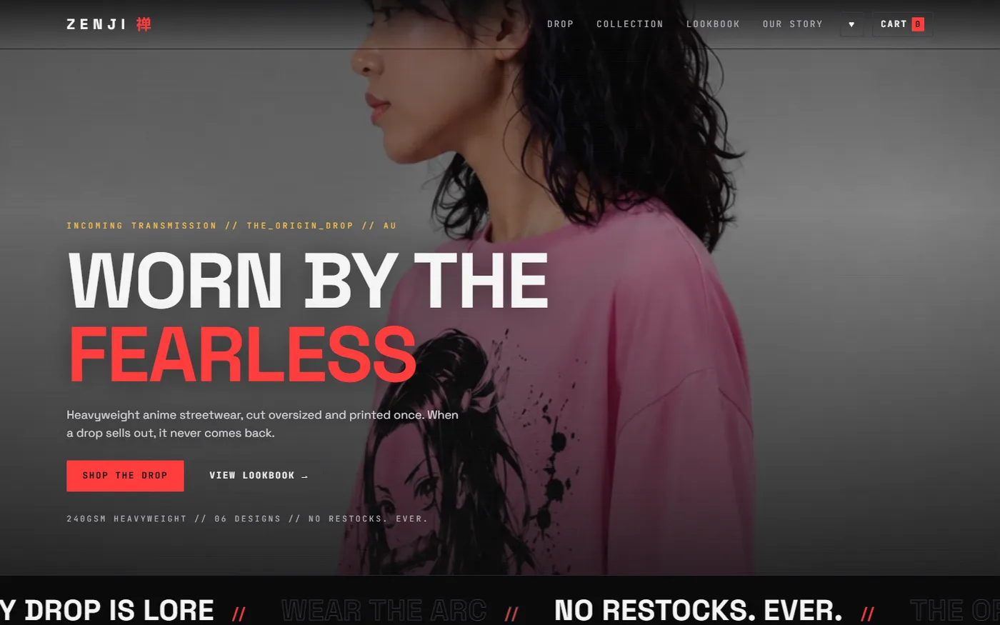
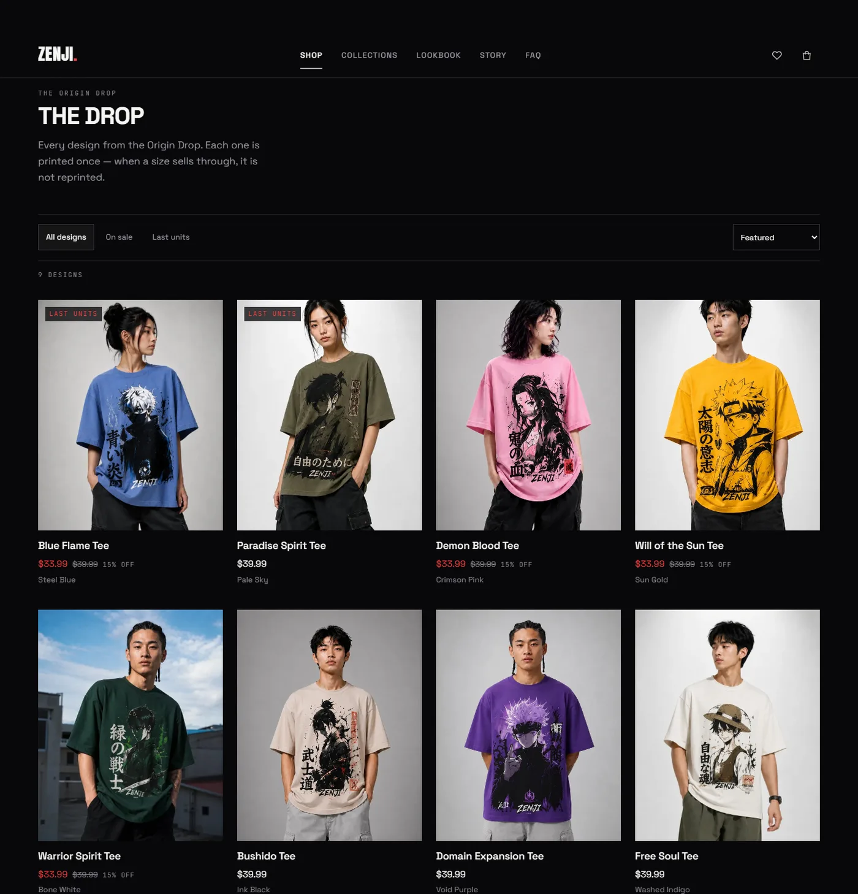
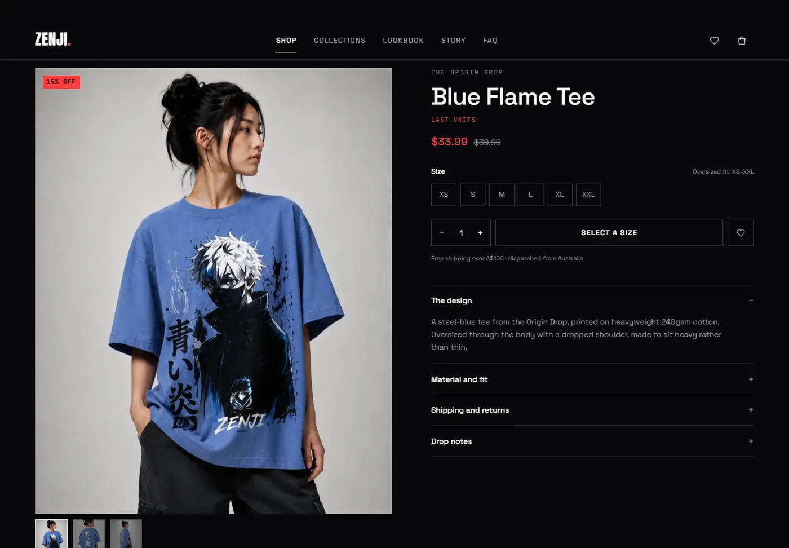
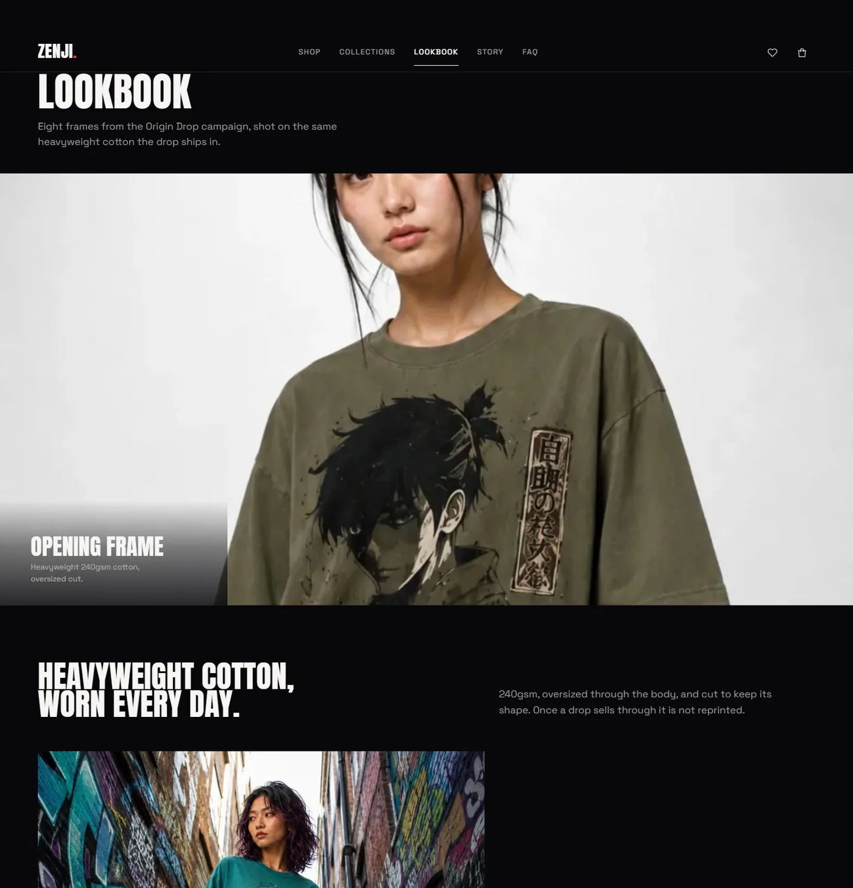
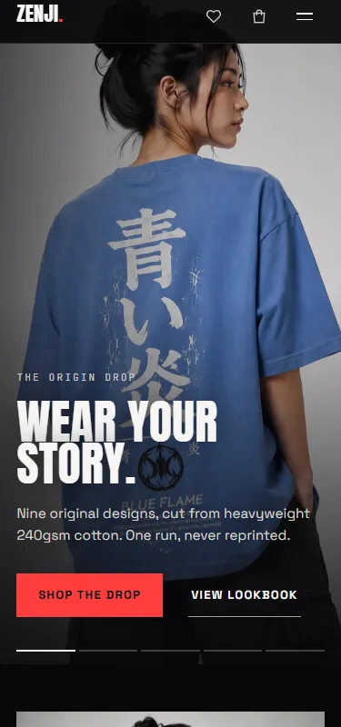
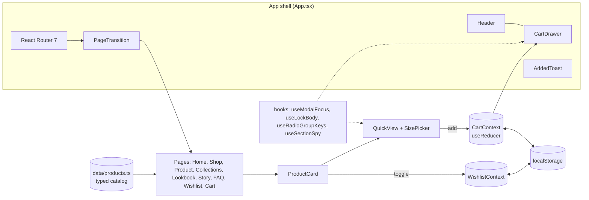

<div align="center">



<p><code>Anime streetwear storefront built as a frontend assessment: React 19, TypeScript and Vite</code></p>

<p>
<a href="https://zenji-webstore.vercel.app"></a>
<a href="https://github.com/Saji-d/zenji-storefront"></a>

</p>

<p>


</p>

<p>
<a href="#-overview">Overview</a> · <a href="#-highlights">Highlights</a> · <a href="#-preview">Preview</a> · <a href="#-architecture">Architecture</a> · <a href="#-tech-stack">Tech Stack</a> · <a href="#-getting-started">Getting Started</a> · <a href="#-project-structure">Structure</a> · <a href="#-roadmap">Roadmap</a> · <a href="#-author">Author</a>
</p>

</div>


## ◈ Overview

ZENJI is a limited-drop anime streetwear storefront: a campaign homepage, a shop, product pages, a lookbook, a cart and a wishlist. I built it as a frontend hiring assessment, so the goal was craft and polish rather than a real commerce backend.

> **Honest scope.** This is a frontend-only demo. There are no payments, accounts, orders or server. The cart and wishlist live in `localStorage`; the catalog is a small typed data file. Nothing leaves the browser.

The design, copy voice and art direction are an original interpretation of the identity of [zenji.shop](https://zenji.shop), an Australian anime streetwear label. It is a study of how a drop-based brand could feel on the web and is not affiliated with or endorsed by ZENJI.


## ◈ Highlights

<table width="100%">
<tr>
<td width="33%" valign="top">

**Quick view**<br/>
Open any product from its card in a bottom sheet on mobile or a split panel on desktop, with the size picker inside.

</td>
<td width="33%" valign="top">

**Cart drawer and page**<br/>
Quantity steppers, removal, sale pricing, subtotal and savings. The drawer is a focus-trapped dialog.

</td>
<td width="33%" valign="top">

**Free-shipping meter**<br/>
A progress bar toward the A$100 threshold. Orders under it use a flat A$9.99 shipping figure.

</td>
</tr>
<tr>
<td width="33%" valign="top">

**Wishlist**<br/>
Heart toggles on cards and product pages, a header badge count and persistence across reloads.

</td>
<td width="33%" valign="top">

**Editorial homepage**<br/>
Hero reel with a preloaded first frame, ticker marquee, drop wall, kinetic brand statement and chapter cards.

</td>
<td width="33%" valign="top">

**Particle footer**<br/>
The wordmark is a canvas particle field that scatters and repels around the cursor. It is hidden from assistive tech and frozen under reduced motion.

</td>
</tr>
<tr>
<td width="33%" valign="top">

**Accessibility**<br/>
Skip link, focus rings, focus traps with restoration, a keyboard-driven radio-group size picker and reduced-motion support.

</td>
<td width="33%" valign="top">

**Tested**<br/>
27 Vitest tests across 3 suites covering cart logic, the app shell and the root.

</td>
<td width="33%" valign="top">

**Audited**<br/>
Headless QA scripts screenshot every route across viewports, probe overflow and run axe-core.

</td>
</tr>
</table>

<details>
<summary><strong>Routes</strong></summary>

| Route | Page |
|---|---|
| `/` | Campaign homepage |
| `/drop` | The shop with availability filters and sorting |
| `/drop/:slug` | Product detail with gallery, size picker and related designs |
| `/collection` and `/collection/:slug` | Collection index and filtered grids |
| `/lookbook` | Editorial gallery |
| `/story` | Brand story |
| `/faq` | FAQ accordion |
| `/wishlist` | Saved designs |
| `/cart` | Full-page bag, mirroring the drawer |
| `*` | Branded 404 |

</details>


## ◈ Preview

<div align="center">

</div>

<br/>

<table width="100%">
<tr>
<td width="50%" align="center"><br/><sub>Campaign hero</sub></td>
<td width="50%" align="center"><br/><sub>The drop (shop)</sub></td>
</tr>
<tr>
<td width="50%" align="center"><br/><sub>Product page with size picker</sub></td>
<td width="50%" align="center"><br/><sub>Lookbook</sub></td>
</tr>
</table>

<div align="center">
<br/><sub>Mobile (375px)</sub>
</div>


## ◈ Architecture

State is plain React: two context providers own the cart (a `useReducer` store) and the wishlist, both mirrored to `localStorage`. Pages read from a typed catalog and the router wraps every page in a transition.




## ◈ Tech Stack

| Layer | Technologies | Purpose |
|---|---|---|
| UI | React 19, TypeScript (strict) | Components and type safety |
| Build | Vite 7 | Dev server and production bundle |
| Routing | React Router 7 | Eleven routes including a 404 |
| Motion | Framer Motion | Page transitions, reveals, animated grid re-flow |
| Styling | CSS Modules and custom-property tokens | Hand-written styles, no UI framework |
| Fonts | Fontsource: Anton, Space Grotesk, JetBrains Mono | Self-hosted, no runtime font requests |
| Testing | Vitest, Testing Library, jsdom | Unit and integration tests |
| QA | playwright-core, axe-core | Screenshots, overflow probe, WCAG scans |
| Hosting | Vercel | Static SPA deployment |


## ◈ Getting Started

Requires Node.js 18 or newer. No environment variables are needed.

```bash
git clone https://github.com/Saji-d/zenji-storefront.git
cd zenji-storefront
npm install
npm run dev        # http://localhost:5173
```

```bash
npm run typecheck  # tsc -b
npm test           # vitest run
npm run build      # typecheck + production bundle in dist/
npm run preview    # serve the production build
```

<details>
<summary><strong>Headless QA scripts (optional)</strong></summary>

The scripts in `scripts/` use `playwright-core` with your installed Chrome. They need the app to be running.

```bash
node scripts/visual-qa.mjs    # screenshots, axe-core and overflow probe
node scripts/routes-qa.mjs    # every route across several viewports
```

</details>


## ◈ Project Structure

<details>
<summary><strong>Show the tree</strong></summary>

```text
.
├── docs/                 # design brief and planning notes
├── public/               # hero frames, lookbook and product images
├── scripts/              # asset pipeline and headless QA scripts
├── src/
│   ├── components/       # Header, Footer, Hero, ProductCard, QuickView, CartDrawer, ...
│   │   └── motion/       # Reveal, PageTransition
│   ├── context/          # CartContext, WishlistContext
│   ├── data/             # product catalog and FAQ content
│   ├── hooks/            # useModalFocus, useCartDrawer, useRadioGroupKeys, ...
│   ├── pages/            # one module per route
│   ├── __tests__/        # Vitest suites
│   ├── App.tsx           # routes and shell
│   └── main.tsx
├── index.html
└── package.json
```

</details>


## ◈ Roadmap

- [x] Quick view, cart drawer, wishlist and free-shipping meter
- [x] Unit tests and automated accessibility scans
- [ ] Back the catalog with a real API or CMS
- [ ] Real checkout, accounts and order flow
- [ ] End-to-end browser tests in CI

> Photography belongs to the referenced brand and serves as placeholder material only. The source code is published for evaluation and portfolio review and has no open-source licence, so all rights are reserved.


## ◈ Author

**Sajidur Rahman Sajid**: Full-Stack Developer and AI engineer from Dhaka.

<p>
<a href="https://www.sajidur.me"></a>
<a href="https://www.linkedin.com/in/sajidur-rahman-sajid/"></a>
<a href="https://github.com/Saji-d"></a>
<a href="mailto:sajidsajidurrahman99@gmail.com"></a>
</p>

<sub>Built with care as a frontend portfolio piece.</sub>
